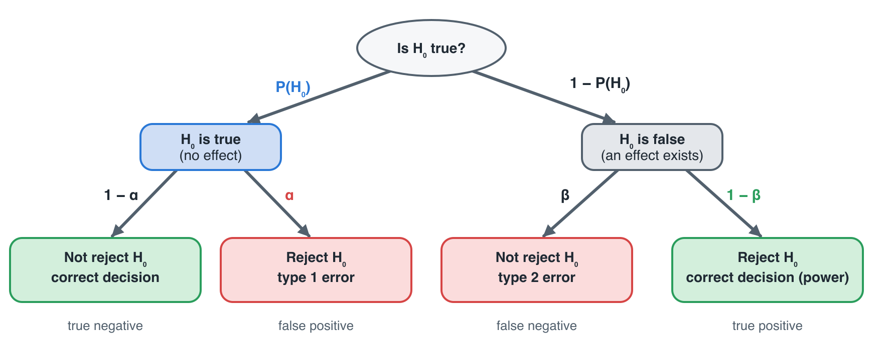

# Null Hypothesis Significance Testing (NHST) {#nhst}

Null Hypothesis Significance Testing (NHST) is a statistical method widely used in research, 
including health sciences, to evaluate whether observed data provide sufficient evidence **to refute** a specific hypothesis. 
It operates within a framework of probability and decision-making to address the following question:

**Are the observed results likely to occur by chance alone if the null hypothesis is true (and other model assumptions are not strongly violated)?**

If one decides that the observed results are unlikely to occur by chance alone, 
the null hypothesis is rejected in favor of an alternative hypothesis.

NHST is **not designed to "prove" hypotheses** but rather to provide evidence against the null hypothesis.
If one reads in a paper that there was "no association", this typically means the 
$p$-value was larger than the arbitrary threshold of $0.05$. This does *not* imply that
there is no association (Misconception 2 [here](https://sixsigmadsi.com/wp-content/uploads/2020/10/A-Dirty-Dozen-Twelve-P-Value-Misconceptions.pdf)).

Underlying NHST is the idea of [falsifiability](https://en.wikipedia.org/wiki/Falsifiability). 
Sometimes one counter example is enough to reject a hypothesis like "all swans are white". 
Seeing one [black swan](https://en.wikipedia.org/wiki/Falsifiability#/media/File:Black_Swans.jpg) 
proves the hypothesis wrong.

**The four possible outcomes of a test.** Before we go through the key concepts, 
look at the whole decision problem in one picture. 
Either $H_0$ is true or it is false, and we do not know which. 
Our test then either rejects $H_0$ or it does not. 
This gives four outcomes: two correct decisions and two errors.



- If $H_0$ is true (probability $P(H_0)$), we reject it with probability $\alpha$. 
  This is a **type 1 error** (false positive). 
  With probability $1 - \alpha$ we correctly do not reject.
- If $H_0$ is false (probability $1 - P(H_0)$), we fail to reject it with probability $\beta$. 
  This is a **type 2 error** (false negative). 
  With probability $1 - \beta$ we correctly reject. The number $1 - \beta$ is the **power**.

Multiplying along the branches gives the probability of each outcome. 
The probability of a wrong decision, a false positive or a false negative, is 
$P(H_0)\,\alpha + (1 - P(H_0))\,\beta$. 
$P(H_0)$ can be read as the share of true null hypotheses among all hypotheses a field tests.
How many of the rejections concern a true null hypothesis depends on all three numbers, not on $\alpha$ alone.

> **Try it yourself.** In the animation
> [H0 and the truth: the tree of the four outcomes](https://jdegenfellner.github.io/Script_QM1_ZHAW/animations/23_H0_Baum_Fehlerarten.html)
> you set $P(H_0)$, $\alpha$ and $\beta$ and watch the tree, the four probabilities, 
> the probability of a wrong decision and the share of false rejections change. 
> The section [Type 1 and Type 2 errors](#error_types) returns to this.

**Key concepts**:

- **Null Hypothesis $H_0$**: This represents the assumption of some specific effect or no effect at all. 
For example, in a clinical trial comparing two treatments, one might state that both treatments have the same effect. 
The alternative is that one treatment is [superior to the other](https://en.wikipedia.org/wiki/Clinical_study_design#Other_terms).

- **Alternative Hypothesis $H_1$**: This is the opposing claim to $H_0$, the logical complement. 
Example: 
   - $H_0: \theta \le 0.4$
   - $H_1: \theta > 0.4$
   - $H_0$ states that the treatment effect is less than or equal to 0.4, 
     while $H_1$ states that the treatment effect is greater than 0.4. 

- **$p$-value**: The $p$-value quantifies the probability of obtaining results (test statistic) as extreme as (or more extreme than) 
the observed data, assuming that $H_0$ is true. 
A smaller $p$-value indicates stronger evidence against $H_0$. 
There are many [misconceptions about $p$-values](https://sixsigmadsi.com/wp-content/uploads/2020/10/A-Dirty-Dozen-Twelve-P-Value-Misconceptions.pdf).

- **Significance level $\alpha$**: Researchers set a threshold to determine whether to reject $H_0$. 
If the $p$-value is smaller than $\alpha$, $H_0$ is rejected in favor of $H_1$.
Note that **there is absolutely no special reason to use $\alpha = 0.05$ as a default value**.
To quote [Ronald Fisher](https://link.springer.com/chapter/10.1007/978-1-4612-4380-9_6) (p.44):
"The value for which P = .05, or 1 in 20, is 1.96 or nearly 2; it is convenient to take this 
point as a limit in judging whether a deviation is to be considered significant or not."
Three decades later, Fisher saw this differently: "No scientific worker has a fixed level of
significance at which from year to year, and in all circumstances, he rejects hypotheses;
he rather gives his mind to each particular case in the light of his evidence and his ideas"
(Fisher 1956, p. 42, as quoted by
[Gigerenzer 2018](https://doi.org/10.1177/2515245918771329)).


**How NHST works**:

- Formulate Hypotheses: Define $H_0$ (e.g., “The new therapy has no effect”) 
  and $H_1$ (e.g., “The new therapy improves outcomes”).

- Determine the necessary sample size to find the effect.

- Collect data: Perform an experiment or study to gather relevant data.

- Calculate the test statistic: Compute a value based on the sample data that 
  reflects the difference or effect under investigation.

- Compute the $p$-value: Determine the probability of observing the 
  test statistic (or more extreme values) if $H_0$ is true.

- Make a decision: Compare the $p$-value to the significance level:
  - If $p < \alpha$: Reject $H_0$; evidence suggests $H_1$ is true.
  - If $p \ge \alpha$: Fail to reject $H_0$; insufficient evidence to support $H_1$.

**(Some) Limitations of NHST**: 

- **Focus on $p$-values with hard cut-offs**: Solely relying on $p$-values can lead to overinterpretation of
  results without considering practical significance.
	
-	**Dichotomous thinking**: The decision to “reject” or “fail to reject” $H_0$ 
  oversimplifies the complexity of real-world data. This binary thinking
  incentivizes researchers to [focus on statistical significance](https://www.tandfonline.com/doi/full/10.1080/00031305.2018.1447512) 
  rather than real relevance. It happened to me not only once that a colleague 
  looked at me with a sad facial expression announcing that the $p$-value was "not significant".
  This should be not an issue at all. The focus should be on doing useful analyses in the most
  rigorous way possible. Note that the [difference between "significant" and "not significant" is
  itself not significant](https://doi.org/10.1198/000313006X152649).

  > **Try it yourself.** Suppose a treatment effect is estimated in two independent groups: 
  > 25 (standard error 10) in group A and 10 (standard error 10) in group B. 
  > Group A gives $p = 0.012$, group B gives $p = 0.32$. 
  > The difference of 15 has a standard error of $\sqrt{10^2 + 10^2} \approx 14.1$ and gives $p = 0.29$. 
  > In the animation
  > ["Significant" versus "not significant"](https://jdegenfellner.github.io/Script_QM1_ZHAW/animations/24_Signifikant_Nicht_Signifikant_Differenz.html)
  > you can change both estimates and their standard errors and watch the three $p$-values and intervals.
	
- **Sample size influence**: Large samples can make small, clinically irrelevant 
  differences "statistically significant". Example: Given an arbitrarily small difference between means of two groups. There is 
  always a sample size that makes the difference "significant". See [Exercise 2](#exercise2_nhst).

  > **Try it yourself.** In the animation
  > [Sample size and the $p$-value](https://jdegenfellner.github.io/Script_QM1_ZHAW/animations/25_Stichprobengroesse_p_Wert.html)
  > two groups differ by a fixed small amount, for example 1 point with a standard deviation of 10. 
  > You change only the sample size per group. The estimate stays the same, the interval around it 
  > shrinks, and the $p$-value falls towards zero, although the difference remains far smaller 
  > than any difference that matters in practice.

- **[Publication bias](https://en.wikipedia.org/wiki/Publication_bias)**: Many journals tended to publish studies with "significant" results. "Not significant" results
  were often not published. This leads to a distorted view of the literature. All rigorously
  conducted studies should be published, irrespective of the results. Estimates of parameters will also be **overestimated**
  when focusing on "significant" results only.

  > **Try it yourself.** In the animation
  > [Publication bias: forest plot and meta-analysis](https://jdegenfellner.github.io/Script_QM1_ZHAW/animations/26_Publikationsbias_Forest_Plot.html)
  > many studies of the same question are simulated. You set the true effect (0 means that $H_0$ is true), 
  > the sample size and the share of unwanted results that still get published. 
  > A meta-analysis of all studies recovers the true effect, a meta-analysis of the published studies alone 
  > does not: it overestimates the effect, because selection by $p$-value keeps the studies that happened 
  > to overshoot.

- **[$p$-hacking](https://de.wikipedia.org/wiki/P-Hacking)**: In the pursuit for "significant" results 
  (which results in publications, which results in tenure), it is natural to do everything to get them. 
  This can include data dredging, selective reporting, and other questionable practices. 
  In my humble opinion, very often, researchers are not to blame but incentives. It is important to understand
  that probabilities are defined *before* an event has happened. The probability for the esteemed reader to win the
  Swiss lottery is rather small and I would take a large bet against it. But every week, someone wins (approximately).
  After the fact, one should not be surprised *that* someone won, 
  since it follows from the [law of large numbers](https://en.wikipedia.org/wiki/Law_of_large_numbers).

  > **Try it yourself.** In the animation
  > [100 true null hypotheses](https://jdegenfellner.github.io/Script_QM1_ZHAW/animations/05_Hundert_Tests_H0_wahr.html)
  > each tile is one test in which there is no effect at all. Choose $\alpha = 5\,\%$ and press the button: 
  > in every run a few tiles light up, and at least one lights up in $99.4\,\%$ of the runs ($1 - 0.95^{100}$).
  > Anyone who reports only the lit tiles reports lottery winners.

- **The probabilistic modus tollens**: "If $H_0$ is true, the data follow an expected pattern. The data do not.
  Therefore $H_0$ is false" is valid logic. Replacing certainty by probability breaks it:
  "If a person is an American, it is highly unlikely that she is a member of Congress.
  This person is a member of Congress. Therefore it is highly unlikely that she is an American."
  A small $P(D \mid H_0)$ does not imply a small $P(H_0 \mid D)$
  ([Gill 1999](https://doi.org/10.1177/106591299905200309)).

- **The inverse probability problem**: The $p$-value is $P(D \mid H_0)$, the probability of the data
  (or more extreme data) given $H_0$. It is not $P(H_0 \mid D)$, the probability that $H_0$ is true given the data.
  [Bayes' theorem](#bayes_statistics) links the two: $P(H_0 \mid D) = \frac{P(H_0)}{P(D)} P(D \mid H_0)$.
  Without the prior $P(H_0)$ we cannot get from one to the other.

- **Low power and replication**: Even with a power of 80%, $p$-values vary strongly from study to study
  ([Cumming 2008](https://doi.org/10.1111/j.1745-6924.2008.00079.x)). A $p$-value therefore says little
  about the $p$-value of an exact replication. See the animation
  [Dance of the p-values](https://jdegenfellner.github.io/Script_QM1_ZHAW/animations/17_Dance_of_the_p_values.html).

- **Confidence intervals predict replications better**: About 83% of the estimates of an exact replication
  fall inside the 95% confidence interval of the first experiment
  ([Cumming 2008](https://doi.org/10.1111/j.1745-6924.2008.00079.x)). The interval therefore tells us more
  about what to expect in the future than the $p$-value does. In the animation
  [The next estimate and the current confidence interval](https://jdegenfellner.github.io/Script_QM1_ZHAW/animations/19_CI_naechste_Schaetzung.html)
  you set the confidence level and check by simulation how often the estimate of a repeated experiment falls inside the first interval.

- **Testing against "no effect"**: NHST tests against a null effect, often one that prior knowledge
  already considers implausible, and it ignores such outside knowledge.

See [Kruschke](https://gwern.net/doc/statistics/bayes/2012-kruschke.pdf) for more limitations of NHST.

In practice, NHST should at least be accompanied by confidence intervals, 
effect size calculations, and a focus on clinical relevance to provide 
a more comprehensive understanding of the results.

This [Review of NHST](https://f1000research.com/articles/4-621/v3) or 
[this overview](https://en.wikipedia.org/wiki/Statistical_hypothesis_test) might be a good entry point.

This [video](https://www.youtube.com/watch?v=FZ2_hzMyJpY&ab_channel=VeryNormal) could also help to understand the basic concepts.

## Example in the literature

$p$-values are omnipresent in the scientific literature. There are rather few papers in our field that do not contain them. 
We **do not use $p$-values in descriptive tables** 
(see [here](https://epitodate.com/the-balance-test-fallacy-why-you-shouldnt-put-p-values-in-table-1/) and 
[here](https://www.acpjournals.org/doi/10.7326/0003-4819-147-8-200710160-00010-w1)).

[Here](https://www.tandfonline.com/doi/full/10.1080/09593980601023754#d1e100) is an example from the literature.
Table 2 lists studies and one column contains $p$-values. Note, that it is not good practice to present $p$-values 
(if one should use them at all) as dichotomy: $p < 0.05$ 
(Misconception 8 [here](https://sixsigmadsi.com/wp-content/uploads/2020/10/A-Dirty-Dozen-Twelve-P-Value-Misconceptions.pdf)). This statement does 
not allow to judge the strength of the evidence against the null hypothesis. Both, $p = 0.00000001$ and $p = 0.049$ would satisfy
the inequality. Since this dichotomy decides around an arbitrary threshold ($\alpha = 0.05$), 
the decision is also somewhat arbitrary.

When reading papers, watch out for oceans of $p$-values and their selective dichotomous interpretation. This is a clear warning sign.

## Binomial test

In the first chapter, we invented the 1000-researcher experiment. There, we have already encountered hypothesis tests in disguise.
If we would assume that the probability of a false positive is 0.04, 
we would "expect" (around) 40 false positives. We asked, what is the probability of observing
137 or more. This is an example of a one-sided hypothesis test:

- $H_0: \theta \le 0.04$
- $H_1: \theta > 0.04$

Under $H_0$, what is the probability to see the observed number (137) of 
false positives (in our case, this is the test statistic) or more?

The answer was $p = 2.3 \cdot 10^{-35}$ (see the first chapter; R prints this as `< 2.2e-16` below, which is just its display limit).

A reasonable person would say, that this result did not happen by chance alone and 
therefore conclude, the true, but unknown false positive rate $\theta$ is larger than 0.04.

Formally, this is called a **(one-sided) [binomial test](https://en.wikipedia.org/wiki/Binomial_test)**.

Note, that **$H_1$ is the logical complement of $H_0$**.

```{r}
# binomial test
binom.test(137, 1000, p = 0.04, alternative = "greater")
```

The output in R tells us the following:

- data: 137 and 1000 successes observed
- alternative hypothesis: true probability of success is greater than 0.04, which we assume afterwards.
- $p$-value < $2.2e-16$. This value is smaller than the precision in R (`.Machine`).
- 95 percent confidence interval: $0.1194241$ to $1.0000000$. 
  The upper limit of $1$ occurs since we have a one-sided test. 
  95% is just convention and has no special meaning.
- Sample estimates: Estimating the true (but unknown) proportion from the sample would just be: 
$\frac{137}{1000} = 0.137$

**Two-sided test**:

- $H_0: \theta = 0.04$
- $H_1: \theta \ne 0.04$

One could argue that this is bad style, since we should probably know the direction of the effect 
(see also 4.2. [here](https://errorstatistics.com/wp-content/uploads/2015/07/cox-1977-with-discussion-and-reply-nc.pdf)).

```{r}
binom.test(137, 1000, p = 0.04, alternative = "two.sided")
```

- alternative = "two.sided", this indicates that we are interested in both directions (higher or lower than $0.04$).
With some experience, one would probably not test for lower when seeing the observed number of 137.
- 95 percent confidence interval: $0.1162817$ to $0.1598810$.

**Interpretation of this frequentist confidence interval (CI)**: When drawing repeated samples, in 95% of the samples,
the so constructed interval (which will be different every time) contains the true but unknown 
parameter (see Illustration [here](https://en.wikipedia.org/wiki/Confidence_interval#/media/File:Normal_distribution_50%25_CI_illustration.svg),
animations of the frequentist nature [here](https://seeing-theory.brown.edu/frequentist-inference/index.html)). 

Note, that the "Exact binomial test" was used. There were no approximations made. I would recommend always
using [exact tests](https://en.wikipedia.org/wiki/Exact_test) if available, since we are in the 21st century and computers are fast.

Again, **the $\alpha$ level of $0.05$ has nothing special (apart from convention) to it**. 
We can also use a $\alpha = 0.14$ level. In this case, we construct confidence intervals 
with a 86% confidence level. We'll discuss the $\alpha$ level [below](#error_types). 
```{r}
binom.test(137, 1000, p = 0.04, alternative = "two.sided", conf.level = 0.86)
```

- confidence interval: $0.1211304$ to $0.1542134$. 

With **smaller coverage probability** (86 instead of 95), we get a **narrower interval**.
Trivially, a 100% confidence interval would be $0$ to $1$ and a 0% confidence interval would be $0.04$ to $0.04$ or any other 
specific value assuming that the true parameter can take any value from $0$ to $1$.

See also [Exercise 3](#exercise3_nhst).

**Comparison with Bayesian version** of estimating $\theta$:

- We cannot include a prior distribution for the parameter $\theta$. 
- We cannot calculate the posterior distribution of $\theta$. 
Hence, we cannot make statements like "the probability that $\theta$ is larger than 0.04 is 0.9".
- Prior knowledge could probably be included in the form of the null hypothesis stating, for instance, that $\theta \le 0.2$. 
This could be based on previous studies or expert knowledge.


## Proportions test

If we are interested in comparing proportions, 
we can use the [proportions test](https://www.rdocumentation.org/packages/stats/versions/3.6.2/topics/prop.test).

### One sample case

$H_0: p = 0.5$. The true, but unknown proportion is 0.5.

$H_1: p \ne 0.5$. The true proportion is different from 0.5.

```{r}
set.seed(443)
heads <- rbinom(1, size = 100,
                prob = 0.5) # create a sample with known probability
prop.test(heads, 100,
          conf.level = 0.94, p = 0.5) # continuity correction TRUE by default
prop.test(heads, 100,
          correct = FALSE,
          conf.level = 0.94, p = 0.5) # no continuity correction
```

- correct = TRUE indicates that a correction ([Yates](https://en.wikipedia.org/wiki/Yates%27s_correction_for_continuity)) 
is used to make the test more accurate and consider the fact that the test statistic is in fact discrete.

- 94% confidence interval: $0.3739955$ to $0.5681618$.

- $\chi^2 = 0.25$. This is the value of the test statistic used in the test. 
Under the null hypothesis (in this case $H_0: p = 0.5$), 
the test statistic follows a [$\chi^2$ distribution](https://en.wikipedia.org/wiki/Chi-squared_distribution).

See also [Exercise 4](#exercise4_nhst).

**Let's verify the test statistic for the test without continuity correction by "hand":**

```{r}
# Observed and expected values
heads <- 47  # Observed count of heads
total <- 100  # Total flips
p_null <- 0.5  # Null hypothesis proportion

# Observed proportion
p_observed <- heads / total

# Z-test statistic
Z <- (p_observed - p_null) / sqrt((p_null * (1 - p_null)) / total)

# Chi-squared test statistic
X_squared <- Z^2

# Print the results
Z
X_squared
```

The $\chi^2$ distribution can be [defined](https://en.wikipedia.org/wiki/Chi-squared_distribution#Definitions) 
as the sum of squared standard normals $Z$. See [Exercise 8](#exercise8_nhst).

**Where does the test statistic come from?**

According to the [central limit theorem](https://en.wikipedia.org/wiki/Central_limit_theorem), 
$\bar{X}$ (= the proportion of successes in the sample) is approximately normally distributed  
$$\bar{X} = \hat{p} \sim N(p, \frac{\sigma^2}{n}) = N(p, \frac{p(1-p)}{n}).$$
This means, the statistic $\hat{p}$ should show the pattern of a Gaußian distribution when repeated many times.
$n$ is in the denominator, so the variance of the approximate normal distribution decreases with increasing sample size and we 
can be more certain about the true proportion with increasing sample size.

Note that we want to find the true but unknown proportion $p$ of a 
[Bernoulli distribution](https://en.wikipedia.org/wiki/Bernoulli_distribution) which has expected value $p$ and variance $p(1-p)$.

Given this distributional statement, it follows that if we subtract the mean assumed under $H_0$ ($p_0 = 0.5$) and divide by the standard deviation,
the resulting test statistic is (approximately) distributed according to a standard normal distribution:

$$Z = \frac{\hat{p} - p_0}{\sqrt{\frac{p_0(1-p_0)}{n}}} \sim N(0, 1).$$

This value squared gives us the value of the test statistic **without continuity correction** above: $0.36$ (with the correction, R reports $0.25$).

#### Or the same with binomial test

$H_0: p = 0.5$ The true but unknown proportion is $0.5$.

$H_1: p \ne 0.5$ The true proportion is different from $0.5$.

This is a two-sided test.

```{r}
set.seed(443)
heads <- rbinom(1, size = 100,
                prob = 0.5) # create a sample with known probability
binom.test(heads, 100,
           conf.level = 0.94, p = 0.5)
```

We get a slightly different $p$-value and confidence interval but the same conclusion.

**Let's also verify the $p$-value and confidence interval by "hand":**

- **$p$-value**: What is the probability that we get 47 successes 
  or more "extreme" (into the direction of the $H_1$) assuming $H_0$ is true?
  
  $p$-value $=\mathbb{P}(\text{Number of successes} \ge 53 \text{ or} \le 47)$.
  ```{r}
  pbinom(47, 100, 0.5) + (1 - pbinom(52, 100, 0.5))
  ```
  And the $p$-value is spot on.

- **94% Confidence interval**: These are the so-called exact [Clopper-Pearson intervals](https://en.wikipedia.org/wiki/Binomial_proportion_confidence_interval#Clopper%E2%80%93Pearson_interval),
since they always have coverage probability of at least $1 - \alpha$.
  
  ```{r}
  binom.test(heads, 100, conf.level = 0.94, p = 0.5)$conf.int
  pbinom(47, 100, 0.5685327)
  1-pbinom(46, 100, 0.3731683)
  ```
  The exact confidence interval is $0.3731683$ to $0.5685327$.
  (The interval from `prop.test` above, $0.3739955$ to $0.5681618$, is a slightly different, approximate interval.)


### More than one proportion {#proportions_test_more_samples}

$H_0: p_1 = p_2 = p_3 = p_4$. Proportions are equal in all 4 groups. The common value is not specified by $H_0$,
it is estimated from the pooled data by $\frac{\sum smokers}{\sum patients} = 0.9370277$.

$H_1: \text{At least one of the proportions is different}$

```{r}
library(tidyverse)
# Data from Fleiss (1981), p. 139.
# H0: The null hypothesis is that the four populations from which
#     the patients were drawn have the same true proportion of smokers.
# H1: The alternative is that this proportion is different in at
#     least one of the populations.

smokers  <- c(83, 90, 129, 70)
patients <- c(86, 93, 136, 82)
categories <- c("Group 1", "Group 2", "Group 3", "Group 4")

data.frame(
  Category = categories,
  Proportion = smokers / patients
) %>%
  ggplot(aes(x = Category, y = Proportion)) +
  geom_bar(stat = "identity", fill = "steelblue", alpha = 0.7) +
  labs(
    title = "Proportion of Smokers in Each Group",
    x = "",
    y = "Proportion"
  ) +
  ylim(0, 1) +
  theme_minimal() +
  theme(plot.title = element_text(hjust = 0.5))

prop.test(smokers, patients)
```

- $p$-value $= 0.005585$. One would argue that this test statistic is unlikely to have come about by chance 
alone and reject the null hypothesis, that all proportions are equal.

- X-squared = 12.6, df = 3. The test statistic is distributed according to a $\chi^2$ distribution 
with 3 [degrees of freedom](https://en.wikipedia.org/wiki/Degrees_of_freedom_(statistics)).
See also [exercise 5](#exercise5_nhst).

  It is not easy to describe what degrees of freedom really are. The common phrase "the number of values that are free to vary"
  is only a rough picture. A geometric explanation is given in this video series by Sam Levey
  ([1](https://www.youtube.com/watch?v=VDlnuO96p58), [2](https://www.youtube.com/watch?v=8e9aDMXRRlc),
  [3](https://www.youtube.com/watch?v=ExQJQPF_Fpk), [4](https://www.youtube.com/watch?v=hsZw9hJspTY)).
  For now, remember this: the degrees of freedom are a **parameter of the distribution of the test statistic under $H_0$**,
  and we can determine it from the setting. Here, the data form a $4 \times 2$ table (smokers and non-smokers in 4 groups),
  and $df = (4-1)(2-1) = 3$.

**The $p$-value is calculated quickly:**
```{r}
pchisq(12.6, df = 3, lower.tail = FALSE)
```

**Let's verify the test statistic by "hand"**:
```{r}
props <- smokers / patients
(p_null <- sum(smokers) / sum(patients))
(Zs <- (props - rep(p_null, 4)) / (sqrt(p_null * (1 - p_null) / patients)))
Zs^2
sum(Zs^2)
```

We get exactly the same result by using 
[Pearson's chi-squared test](https://en.wikipedia.org/wiki/Pearson%27s_chi-squared_test).

Formally, this is a [chi-squared test for independence](https://en.wikipedia.org/wiki/Chi-squared_test#Test_of_independence).

$H_0:$ Here, we test if the proportion of smokers is independent of the group.

If the $H_0$ is true, the number of smokers/non-smokers (in each cell) is just determined 
by the number of smokers/non-smokers
in the sample, how many people are in the respective group and the total number 
of people in the sample.

```{r}
sm1 <- c(rep("smoke", 83), rep("nosmoke", 3))
sm2 <- c(rep("smoke", 90), rep("nosmoke", 3))
sm3 <- c(rep("smoke", 129), rep("nosmoke", 7))
sm4 <- c(rep("smoke", 70), rep("nosmoke", 12))
sm <- c(sm1, sm2, sm3, sm4)
grp <- c(rep("A", 86), rep("B", 93), rep("C", 136), rep("D", 82))
d <- data.frame(sm, grp)

table(d$sm, d$grp)
chisq.test(table(d$sm, d$grp))
```

**Let's verify the test statistic by "hand":**

Degrees of freedom are: 
$df = (number\_of\_columns - 1) \cdot (number\_of\_rows - 1) = 3 \cdot 1 = 3$. 


```{r}
# Observed data
observed <- matrix(c(3, 83, 3, 90, 7, 129, 12, 70), nrow = 2, byrow = FALSE)
rownames(observed) <- c("nosmoke", "smoke")
colnames(observed) <- c("A", "B", "C", "D")

# Calculate row totals, column totals, and grand total
row_totals <- rowSums(observed)
col_totals <- colSums(observed)
grand_total <- sum(observed)

# Calculate expected counts
expected <- outer(row_totals, col_totals, FUN = "*") / grand_total

print(observed)
print(expected)

# Chi-squared statistic
sum((observed - expected)^2 / expected)
```

For example, the first cell (nosmoke in group A) in the table is calculated as follows:
$\frac{86 \cdot 25}{397} = \frac{86}{397} \cdot \frac{25}{397} \cdot 397 = 5.415617$. 
These are the expected values in this cell, 
if one would assume that the proportion of smokers does not depend on the group.
Hence, one just multiplies the column ($86/397$) and row ($25/397$) proportions
and multiplies with the grand total ($397$) to get the absolute number of observations
in each cell under $H_0$.

### Fisher's exact test

As mentioned above, **we should always use exact tests if available**.
For the test for independence, we could also use 
[Fisher's exact test](https://en.wikipedia.org/wiki/Fisher%27s_exact_test).
The underlying distribution for the test statistic is a hypergeometric distribution.

```{r}
fisher.test(table(d$sm, d$grp))
```


## (Classical) $t$-test
The [$t$-test](https://en.wikipedia.org/wiki/Student%27s_t-test) is one of the most 
famous classical statistical tests out there. 
Consider these links: [1](https://www.youtube.com/watch?v=pXuFeRCMTAo&ab_channel=VeryNormal)
[2](https://www.youtube.com/watch?v=pLNuDye_tq4&ab_channel=VeryNormal)
as starting point.
[This article](https://www.bmj.com/about-bmj/resources-readers/publications/statistics-square-one/7-t-tests) could also be interesting.

With the $t$-test, we want to answer the question 

- if the true, but unobserved mean of a population is different from a 
specific value ([one sample $t$-test](https://en.wikipedia.org/wiki/Student%27s_t-test#One-sample_t-test)) or

- if the true, but unobserved means of two populations are different from each other ([two sample $t$-test](https://en.wikipedia.org/wiki/Student%27s_t-test#Two-sample_t-tests)).
  - [independent samples](https://en.wikipedia.org/wiki/Student%27s_t-test#Independent_two-sample_t-test)
  - [paired samples](https://en.wikipedia.org/wiki/Student%27s_t-test#Dependent_t-test_for_paired_samples)

Conveniently, R has a built-in function for these tests.


### One sample $t$-test

$H_0: \mu = \mu_0 = 25$

$H_1: \mu \ne \mu_0 = 25$

Let's perform a one sample [$t$-test in R](https://www.sthda.com/english/wiki/one-sample-t-test-in-r) 
(and let's ignore the Shapiro-Wilk test in the link):

```{r}
set.seed(1234)
my_data <- data.frame(
  name = paste0(rep("M_", 10), 1:10),
  weight = round(rnorm(10, 20, 2), 1)
)
head(my_data, 10)
summary(my_data$weight)

library(ggpubr)
ggboxplot(my_data$weight,
          ylab = "Weight (g)", xlab = FALSE,
          ggtheme = theme_minimal())

ggqqplot(my_data$weight, ylab = "Mouse weight (g)",
         ggtheme = theme_minimal())

t.test(my_data$weight, mu = 25,
       alternative = "two.sided", conf.level = 0.94)

t.test(my_data$weight, mu = 25,
       alternative = "less", conf.level = 0.94)

t.test(my_data$weight, mu = 25,
       alternative = "greater", conf.level = 0.94)
```

Let's verify the test statistic by "hand" for the two-sided test:

$$t = \frac{\bar{X} - \mu_0}{s/\sqrt{n}}$$

$\bar{x} = 19.25$

$s = 2.002915$

$n = 10$

$t = \frac{19.25 - 25}{2.002915/\sqrt{10}} = -9.078319$

Under the null hypothesis and 
[assumptions](https://en.wikipedia.org/wiki/Student%27s_t-test#Assumptions) met, 
the test statistic is distributed according 
to a $t$-distribution with 9 degrees of freedom.
Hence, the $p$-value is:
```{r}
pt(-9.078319, df = 9) * 2 # two-sided
```
This matches the output of the `t.test` function in R.

**[Assumptions of the $t$-test](https://en.wikipedia.org/wiki/Student%27s_t-test#Assumptions)**:

You will often see that researchers check if the *data* is normally distributed. 
This is not strictly necessary. Merely $\bar{X}$ (instead of the raw data) must be normally distributed, which is
often guaranteed by the 
[central limit theorem](https://en.wikipedia.org/wiki/Central_limit_theorem) for a 
large enough sample size $n$.

**IF the data is normally distributed, then $\bar{X}$ is exactly normally distributed**. 
This is always true 
and is probably the reason for testing for normality of the data.

Another assumption is that $\frac{s^2(n-1)}{\sigma^2} \sim \chi^2_{n-1}$

**Let's try to verify this assumption empirically:**

```{r}
# Load necessary libraries
library(ggplot2)

# Parameters
n <- 10            # Sample size
mu_0 <- 25         # Mean under null hypothesis
sigma <- 1         # Standard deviation
num_simulations <- 10000  # Number of simulations

# Simulations
set.seed(42)  # For reproducibility
chi_squared_values <- numeric(num_simulations)

for (i in 1:num_simulations) {
  # Generate random sample
  sample <- rnorm(n, mean = mu_0, sd = sigma)
  # Calculate sample variance
  sample_variance <- var(sample)
  # Calculate chi-squared value
  chi_squared_values[i] <- (n - 1) * sample_variance / sigma^2
}

data.frame(chi_squared = chi_squared_values) %>%
  ggplot(aes(x = chi_squared)) +
  geom_histogram(aes(y = after_stat(density)), bins = 50,
                 fill = "lightblue", color = "white") +
  stat_function(fun = dchisq, args = list(df = n - 1),
                color = "red", linewidth = 1) +
  labs(
    title = expression("Empirical Verification of " ~ chi^2 ~ " Distribution"),
    x = "Value",
    y = "Density"
  ) +
  theme_minimal() +
  theme(
    plot.title = element_text(hjust = 0.5)
  )
```

This assumption seems to be met.

The last assumption listed is that $Z = \bar{X} - \mu$ and $s$ are independent.
$Z$ measures how far $\bar{X}$ is from $\mu$. Independence would mean here
that irrespective of how far away a sample is from the true mean 
(respectively the mean under $H_0$), the sample variance
has the same distribution. 

One could verify this theoretically or by applying an 
[independence test](https://en.wikipedia.org/wiki/Hoeffding%27s_independence_test).


### Two sample $t$-test

$H_0: \mu_1 = \mu_2$

$H_1: \mu_1 \ne \mu_2$

Let's jump right in and use our example from the previous chapter where we performed the Bayesian $t$-test:

```{r, echo=TRUE}
(y1 <- c(-.5, 0, 1.2, 1.2, 1.2, 1.9, 2.4, 3) * 100)
(y2 <- c(-1.2, -1.2, -.5, 0, 0, .5, 1.1, 1.9) * 100)

length(y1)
length(y2)

data <- data.frame(y1, y2)
psych::describe(data)

# Boxplot:
data.frame(y = c(y1, y2), group = c(rep(1, 8), rep(2, 8))) %>%
  ggplot(aes(x = factor(group), y = y)) +  # Use factor for discrete x-axis
  geom_boxplot() +                        # Add boxplot layer
  geom_jitter(width = 0.1)                # Add jitter for individual
# -> Visually, there seems to be a difference between the two groups.

t.test(y1, y2, conf.level = 0.93)
```

- The test statistic follows a $t$-distribution with $13.928$ degrees of freedom (under $H_0$).
  The non-integer value comes from the Welch correction: by default, `t.test` does not assume equal variances
  in the two groups ("Welch Two Sample t-test"). With `var.equal = TRUE` one gets the classical pooled test
  with $n_1 + n_2 - 2 = 14$ degrees of freedom and $p = 0.04624$, here almost the same.
- The value of the test statistic is $2.1867$.
- $H_0: \mu_1 = \mu_2$. The group means are equal.
- $H_1: \mu_1 \ne \mu_2$. The group means are different.
- $p$-value $= 0.04634$. In the classical framework, 
  this would be considered "significant" at the $\alpha = 0.05$ level 
  and one would reject the null hypothesis and accept the alternative hypothesis.
  **In the Bayesian framework, we abstained from making a decision**.
- 93% confidence interval for the difference in means is rather wide: 
  $12.55847$ to $232.44153$.

  Let's try to visualize this. 
  
  **Under the assumption** that there is **no difference in means**,
  the [test statistic](https://en.wikipedia.org/wiki/Student%27s_t-test#Equal_or_unequal_sample_sizes,_unequal_variances_(sX1_%3E_2sX2_or_sX2_%3E_2sX1)) 
  
  $$ t = \frac{\bar{X}_1 - \bar{X}_2}{\sqrt{\frac{s_1^2}{n_1} + \frac{s_2^2}{n_2}}} $$
  
  would be distributed according to a $t$-distribution with 13.928 degrees of freedom.

```{r}
# Load ggplot2
library(ggplot2)

# Define degrees of freedom
df_t <- 13.928

# Define the range for x and the observed t-value
x <- seq(-4, 4, length.out = 500)
t_obs <- 2.1867

# Create a data frame with x and corresponding density values
t_dist <- data.frame(
  x = x,
  density = dt(x, df_t)
)

# Plot the t-distribution with shaded tail areas
ggplot(t_dist, aes(x = x, y = density)) +
  # Add the main t-distribution curve
  geom_line(linewidth = 1, color = "blue") +
  # Add shaded areas below the curve beyond the observed t-value
  geom_ribbon(
    data = subset(t_dist, x < -t_obs),
    aes(ymin = 0, ymax = density),
    fill = "red",
    alpha = 0.3
  ) +
  geom_ribbon(
    data = subset(t_dist, x > t_obs),
    aes(ymin = 0, ymax = density),
    fill = "red",
    alpha = 0.3
  ) +
  # Add vertical lines for the observed t-value
  geom_vline(xintercept = c(-t_obs, t_obs),
             linetype = "dashed", color = "black") +
  # Annotate the observed t-value
  annotate("text", x = -t_obs, y = 0.05,
           label = paste0("-t = ", t_obs), angle = 90, vjust = -0.5) +
  annotate("text", x = t_obs, y = 0.05,
           label = paste0("t = ", t_obs), angle = 90, vjust = -0.5) +
  # Add labels and style
  labs(
    title = "t-Distribution with Shaded Tail Areas Beyond the Observed t (Two-Sided Test)",
    subtitle = paste("Degrees of Freedom:", df_t),
    x = "t",
    y = "Density"
  ) +
  theme_minimal() +
  theme(
    plot.title = element_text(hjust = 0.5),  # Center the title
    plot.subtitle = element_text(hjust = 0.5)  # Center the subtitle
  )

# p-value manually:
pt(-2.1867, df_t) * 2
```

The plot shows the $t$-distribution. Marked in red are the areas where the test statistic 
takes the value we observed or "more extreme" values. With "more extreme" we mean values that are
further away from 0 in both directions since we conducted a two-sided test. The area under the curve
is the $p$-value. As you can see, the $p$-value is the sum of the two red areas and matches the output 
of the $t$-test function in R.

Interesting: [This R-file](https://github.com/jdegenfellner/ZHAW_Teaching/blob/main/Influence_of_outlieres_on_t-Test.R) demonstrates what one single outlier can do to a $t$-test.

### Paired $t$-test
In the last case, we assume, that the two samples are *not* independent anymore. We could, for instance,
think of two weight measurements (kg) of the same person before and after a diet. Obviously, 
these two measurements are not independent. Higher pre-diet weights could be associated
with higher post-diet weights.

Analog to before, we now ask if the differences are "significantly" different from $\mu_0$.

In the bodyweight example, let's define a 5 kg weight loss as clinically relevant 
(in reality this is more like 5%), but we keep it simple.

$H_0: \mu_D \le \mu_0 = 5~kg$. Participants lost 5 kg or less on average, 
i.e. the true difference between pre- and post weight is on average smaller than 5kg.

$H_1: \mu_D > \mu_0 = 5~kg$. Participants lost more than 5 kg on average.

Assumptions for the paired $t$-test:
- Interval or ratio scale
- The differences are independent of each other

Let's create some data and perform the test:

```{r}
library(pacman)
p_load(MASS, tidyverse)

# Create correlated pre post weight-data
set.seed(62)  # For reproducibility
n <- 15  # Number of pairs
mu <- c(80, 73)  # Mean vector for Pre and Post weights
rho <- 0.7  # Correlation
sigma <- 10  # Standard deviation for both variables

Sigma <- matrix(c(sigma^2, rho * sigma^2, rho * sigma^2, sigma^2), nrow = 2)
weights <- mvrnorm(n, mu = mu, Sigma = Sigma)

df <- data.frame(
  Pre_Weight = round(weights[, 1], 2),
  Post_Weight = round(weights[, 2], 2)
)
df
cor(df$Pre_Weight, df$Post_Weight)

df %>% mutate(pre_post_diff = Pre_Weight - Post_Weight) %>%
  ggplot(aes(x = Pre_Weight, y = Post_Weight)) +
  geom_point() +
  labs(title = "Pre-Post Weights with the same person",
       x = "Pre-Weight [kg]",
       y = "Post-Weight [kg]") +
  theme(plot.title = element_text(hjust = 0.5))

t.test(df$Pre_Weight, df$Post_Weight, paired = TRUE,
       alternative = "greater", mu = 5)
```

**Let's verify the test statistic and $p$-value by "hand":**

```{r}
mean_diff <- mean(df$Pre_Weight - df$Post_Weight)
sd_diff <- sd(df$Pre_Weight - df$Post_Weight)
n <- nrow(df)
t_stat <- (mean_diff - 5) / (sd_diff / sqrt(n))
t_stat

pt(-t_stat, df = n - 1)
```

Conclusion: The observed mean difference in weights is explainable by chance alone ($p$-value rather high).
We continue to believe in $H_0$.

## Correlation test

In the chapter about descriptive statistics, we calculated the (Pearson) correlation coefficient 
to measure the strength of the **linear** relationship between two variables.

Often, the null hypothesis for the correlation coefficient is that there is no correlation between 
the two variables ($\rho=0$). One could argue that this is a rather baseless assumption. In reality,
the true correlation coefficient is probably not exactly 0 and one could argue more precisely a range
of plausible values for $\rho$ for the specific case at hand. Often, one can see an ocean of $p$-values
in the literature, where the correlation coefficient is tested against 0. This is superfluous.
For example, if the sample size is $n=234$ and the sample correlation coefficient is $r = 0.76$, it 
is very unlikely that the true correlation coefficient is 0. One does not need a hypothesis test to 
know this (see [exercise 6](#exercise6_nhst)).

### Classical correlation test

We can do a correlation test in R with the `cor.test` function. 
[This article](https://www.sthda.com/english/wiki/correlation-test-between-two-variables-in-r) is also helpful.
Maybe, let's take the part about the Shapiro-Wilk test not too seriously.

The test statistic(s) for the test(s) can be found [here](https://en.wikipedia.org/wiki/Pearson_correlation_coefficient#Inference).
If we really want to take the result of such a test seriously, we need to check the assumptions of the test.
[This](https://core.ac.uk/download/pdf/234680353.pdf) might be an interesting read.

The correlation plot from the [article](https://www.sthda.com/english/wiki/correlation-test-between-two-variables-in-r) looks like this:
```{r}
library(ggpubr)
mtcars %>%
  ggscatter(x = "mpg", y = "wt",
            add = "reg.line", conf.int = TRUE,
            cor.coef = TRUE, cor.method = "pearson",
            xlab = "Miles/(US) gallon", ylab = "Weight (1000 lbs)")

cor.test(mtcars$mpg, mtcars$wt, conf.level = 0.96)
```

$r=-0.87$ is the sample correlation coefficient. 
Interestingly, `cor.test` in R can only test $H_0: \rho = 0$.

In the scatter plot, we can see a linear relationship between the two variables.
The correlation might therefore be a useful measure to describe the relationship between the two variables.

- t is the $t$-test statistic value (t = -9.559),
- df is the degrees of freedom (df= 30),
- $p$-value of the $t$-test ($p$-value = $1.294 \cdot 10^{-10}$).
- conf.int is the confidence interval of the correlation coefficient at 96% (conf.int = $[-0.9360192, -0.7362129]$)
  This is what is most interesting to us and should be interpreted in the context of the data.
- sample estimates is the correlation coefficient ($r = -0.87$).

**Let's verify the test statistic for the two-sided test by "hand":**

For pairs **from an uncorrelated bivariate normal distribution**, the sampling distribution 
of the studentized Pearson's correlation coefficient follows a $t$-distribution with degrees of freedom $n − 2$. 
Specifically, if the underlying variables have a bivariate normal distribution, the variable

$$t = \frac{r \sqrt{n-2}}{\sqrt{1-r^2}}$$

has a student's $t$-distribution in the null case (zero correlation).

```{r}
(r <- cor(mtcars$mpg, mtcars$wt))
(n <- nrow(mtcars))
(t <- r * sqrt(n - 2) / sqrt(1 - r^2))
(p <- 2 * pt(-abs(t), df = n - 2))
```

This matches the output of the `cor.test` function in R.

Study this [file](https://github.com/jdegenfellner/ZHAW_Teaching/blob/main/Variability_of_Correlation_under_H_0.R) 
to understand the variability of the sample correlation coefficient under the null hypothesis ($\rho=0$). 
Please be aware of this variability when interpreting the results of your master thesis.

### Bootstrap confidence interval for the correlation coefficient

We could also use the so-called **simple non-parametric [bootstrap](https://en.wikipedia.org/wiki/Bootstrapping_(statistics))** to estimate the confidence interval for the correlation coefficient.
These are the steps:

- Create a new sample by [drawing with replacement](https://upload.wikimedia.org/wikipedia/commons/4/4a/Illustration_bootstrap.svg) from the original sample.
- Repeat this process many times (e.g., 1000 times).
- Calculate the correlation coefficient for each new sample.
- Calculate adequate sample quantiles of the correlation coefficients to get a confidence interval.

There is a simple elegance to this method. It is very general and can be applied to many different problems.

Let's apply it to finding a confidence interval for the correlation coefficient between `mpg` and `wt` in the `mtcars` dataset.

```{r}
# Bootstrap confidence interval for the correlation coefficient
set.seed(123)
cors <- replicate(1000, {
  idx <- sample(1:n, n, replace = TRUE)
  cor(mtcars$mpg[idx], mtcars$wt[idx])
})
hist(cors)
quantile(cors, c(0.02, 0.5, 0.98)) # 96% confidence interval
```

We used the variability **contained in the data** to estimate the variability of 
the correlation coefficient. As you can see in the histogram, correlations close to 0 are
very unlikely. The 96% bootstrap confidence interval is $[-0.926, -0.782]$.

You can also study the nice animation of the bootstrap [here](https://seeing-theory.brown.edu/frequentist-inference/index.html).

### Comparison with Bayesian approach

For the Bayesian approach, we can use the `correlationBF` function from 
the `BayesFactor` package. In analogy to the classical test, we can "test" the null hypothesis
by assuming a prior distribution for the correlation coefficient symmetric around the 
value 0 (see prior plot below).

```{r}
library(BayesFactor)
library(tidyverse)

set.seed(444)

# Define a function for the shifted, scaled Beta prior
shifted_beta_prior <- function(rho, rscale) {
  # Transform Beta to [-1, 1]
  if (rho >= -1 && rho <= 1) {
    # (rho + 1) / 2 transforms [-1, 1] to [0, 1]
    beta_density <- dbeta((rho + 1) / 2, 1 / rscale, 1 / rscale) / 2
    return(beta_density)
  } else {
    return(0)
  }
}

# Define rho values and rscale
rho_values <- seq(-1, 1, by = 0.01)
rscale <- 1 / 3  # Medium scale

# Compute prior values
prior_values <- sapply(rho_values, shifted_beta_prior, rscale = rscale)

# Plot the prior
data.frame(rho = rho_values, density = prior_values) %>%
ggplot(aes(x = rho, y = density)) +
  geom_line(color = "blue", linewidth = 1.2) +
  labs(
    title = "Shifted Scaled Beta Prior Distribution for Correlation",
    x = expression(paste("Correlation (", rho, ")")),
    y = "Density"
  ) +
  theme_minimal() +
  theme(
    plot.title = element_text(hjust = 0.5, size = 16),
    text = element_text(size = 14)
  )

# Compute the posterior samples using correlationBF()
posterior_samples <- correlationBF(
  # Bayes factors or posterior samples for correlations.
  y = mtcars$mpg,
  x = mtcars$wt,
  # Use "medium" scale (1/3); prior scale. Preset values can be given as strings
  rscale = "medium",
  posterior = TRUE,     # Get posterior samples
  iterations = 10000    # Number of MCMC iterations
)
# Independent-candidate M-H = Independent-candidate Metropolis-Hastings algorithm

posterior_samples %>%
ggplot(aes(x = rho)) +
  geom_histogram(aes(y = after_stat(density)),
                 bins = 30, fill = "lightblue", color = "black") +
  geom_density(color = "blue", linewidth = 1.2) +
  labs(
    title = expression(paste("Posterior Distribution of Correlation (", rho, ")")),
    x = expression(paste("Correlation (", rho, ")")),
    y = "Density"
  ) +
  theme_minimal() +
  theme(
    plot.title = element_text(hjust = 0.5, size = 16),
    text = element_text(size = 14)
  )

# Compute 96% credible interval
credible_interval <- quantile(posterior_samples[, "rho"], probs = c(0.02, 0.98))
cat("96% Credible Interval for rho:",
    credible_interval[1], "to", credible_interval[2], "\n")
median(posterior_samples[, "rho"])
```

The following intervals were obtained in three different ways:

- Classical frequentist: 
  - 96% confidence interval: $[-0.9360192, -0.7362129]$
  - Estimate: $-0.8676594$
- Bootstrap: 
  - 96% bootstrap confidence interval: $[-0.926, -0.782]$
  - Median of the bootstrap samples: $-0.8745279$
- Bayesian: 
  - 96% credible interval: $[-0.9083272, -0.6384908]$
  - Median of the posterior samples: $-0.8159496$

[This](https://seeing-theory.brown.edu/frequentist-inference/index.html) 
website should be fun to explore.


## Type 1 and Type 2 errors {#error_types}
```{r error_table_fixed, echo=FALSE}
library(knitr)

# Define the data
data <- data.frame(
  "Decision about null hypothesis (H0)" = c("Not reject", "Reject"),
  "Null hypothesis (H0) is true" = c(
    "Correct inference (true negative)\n(probability = 1 - α)",
    "Type I error (false positive)\n(probability = α)"
  ),
  "Null hypothesis (H0) is false" = c(
    "Type II error (false negative)\n(probability = β)",
    "Correct inference (true positive)\n(probability = 1 - β)"
  )
)

# Render the table
kable(data, format = "html", align = "c", row.names = FALSE,
      col.names = c("Decision about null hypothesis (H0)",
                    "Null hypothesis (H0) is true",
                    "Null hypothesis (H0) is false"))
```

The tree at the [beginning of this chapter](#nhst) shows how the four outcomes fit together. 
In the dichotomous world of hypothesis testing, we can make [two types of errors](https://en.wikipedia.org/wiki/Type_I_and_type_II_errors):

- A type 1 error (false positive) occurs when we reject the null hypothesis when it is actually true.
- A type 2 error (false negative) occurs when we do not reject the null hypothesis when it is actually false.

The expression $1 - \beta$ is called the **power** of the test. 
It is the probability of correctly rejecting the null hypothesis when it is false.

[This](https://github.com/jdegenfellner/ZHAW_Teaching/blob/main/H_0_and_the_truth.R) R-file 
could be interesting to study with respect to $H_0$ and the probability of finding the truth.

**How to choose $\alpha$ and $\beta$?**

So far, I have not seen this question answered in a practical way in papers. 
One typically reads
that "the level of statistical significance is set at $\alpha = 0.05$", which is arbitrary.

[Mudge et al. (2012)](https://journals.plos.org/plosone/article?id=10.1371/journal.pone.0032734) 
answer the question like this: 
"Thus, the logical decision-making significance threshold, $\alpha$, 
should be the value that minimizes the probability, or occasionally, 
the cost of making any relevant error."

We have encountered the argument, that Bayesian statistics is subjective.
Unfortunately, a similar problem arises in NHST. To quote Mudge et al. again:

"... consistently using $\alpha = 0.05$ is not an objective approach. Subjectivity is 
merely shifted away from the choice of $\alpha$ to the choice of sample size, such 
that if a researcher wants to find statistical significance using $\alpha = 0.05$, 
they should conduct a test with a large sample size ..."

For the case of equal a priori probability of the $H_0$ and $H_1$ and equal consequence 
for both types of errors, they suggest to [choose alpha by minimizing](https://journals.plos.org/plosone/article/figure?id=10.1371/journal.pone.0032734.g002)

$$\omega = \frac{\alpha + \beta}{2}.$$


## The frequentist confidence interval

**In frequentist statistics, a [confidence interval (CI)](https://en.wikipedia.org/wiki/Confidence_interval) is an interval computed by a procedure that, with repeated sampling, 
contains the true but unknown parameter in a certain percentage of the samples (the confidence level).**

It is very important to understand that for every sample, the confidence interval is different and in the long run,
these intervals will contain the true parameter in a certain percentage of cases.

This is a [nice visualization](https://en.wikipedia.org/wiki/Confidence_interval#/media/File:Normal_distribution_50%25_CI_illustration.svg) 
of the concept.
See also [exercise 7](#exercise7_nhst).

> **Try it yourself.** In the animation
> [Confidence intervals: what "95 %" really means](https://jdegenfellner.github.io/Script_QM1_ZHAW/animations/16_Konfidenzintervalle_frequentistisch.html)
> each click draws a new sample from a distribution with known true mean and builds a confidence interval.
> The intervals pile up, and you can see how many of them contain the true mean and how many miss it.

**1:1 relationship between $p$-values and confidence intervals:**

There is a 1:1 relationship between "statistical significance" and confidence intervals.

- Example 1: If we test ($\alpha = 0.06$) the null hypothesis that the mean of a population 
  is 0 ($H_1: \mu \ne 0$), 
  and we get a $p$-value of 0.0298, then the 94% confidence interval **for the mean** 
  will not contain 0.

- Example 2: If we test ($\alpha = 0.07$) the null hypothesis that means of two independent
  populations are equal ($H_1: \mu_1 \ne \mu_2$), and we get a $p$-value of 0.0433, 
  then the 93% confidence interval for the **difference in means** will not contain 0.

- Example 3: If we test ($\alpha = 0.03$) the null hypothesis that the risk ratio for 
  lung cancer equals 1 in smokers vs. non-smokers ($H_1: RR \ne 1$), and we get a 
  $p$-value of 0.00032, then the 97% confidence interval for the **risk ratio (RR)** 
  will not contain 1.

## Simulations based approaches

Through the power of modern computers, we can simulate all kinds of hypothesis tests. 
We just assume that the null hypothesis is true and draw samples from that very distribution.
In the old times, computational resources were scarce and one had to rely on 
[tables](https://digital.library.adelaide.edu.au/server/api/core/bitstreams/21f22d02-4a39-4650-8f09-71434ad02897/content)
that were precalculated. 

[This](https://github.com/jdegenfellner/ZHAW_Teaching/blob/main/Variability_of_Correlation_under_H_0.R)
shows you how the correlation coefficient behaves under the null hypothesis (that there is no correlation; $\rho = 0$).
This is a very useful tool to understand the behavior of a test statistic under the null hypothesis.
Of course, it is hardly plausible that the true correlation is exactly 0,
but in practice we are interested in "indistinguishable from 0" which is a small value. 
In the Bayesian framework from Kruschke, we defined a region of practical equivalence (ROPE) for this purpose.

**We ask ourselves**: What does my test statistic do *if* the null hypothesis is true?
Then try to simulate it. This helps to understand what constitutes a qualitatively different result 
(from the null hypothesis) considering variability in the data.

## Exercises

### Exercise 1 - frequentist confidence interval {#exercise1_nhst}

- Create 1000 random samples from a binomial distribution with $n = 100$ and $p = 0.38$.
- Calculate the 96% confidence interval for each sample using R.
- How often was the true parameter ($p = 0.38$) contained in the constructed interval?

### Exercise 2 - everything becomes "significant" {#exercise2_nhst}

Setting: two sample $t$-test. Assume there is a small difference between the means of two groups.
- Show via simulation that with increasing sample size, the $p$-value becomes smaller and 
smaller and will be "significant" at some point irrespective of how small the true mean 
difference is and how small the $\alpha$-level is.

### Exercise 3 - binomial test {#exercise3_nhst}

- Create a sample from a binomial distribution with $n = 54$ and $p = 0.68$.
- Perform a two-sided binomial test with $H_0: p = 0.5$.
- Calculate the 90% confidence interval for the true proportion.
- Calculate the p-value for the two-sided test by "hand" (using dbinom/pbinom in R).

### Exercise 4 - proportions test {#exercise4_nhst}

- Create a sample from a binomial distribution with $n = 100$ and $p = 0.5$.
- Perform a proportions test with $H_0: p = 0.5$ and interpret the results.
- Perform the proportions test with the whole range of possible proportions
  $H_0: p = 0.01 \cdots p = 0.99$ in steps of $0.01$. 
  And plot the p-values on the y-axis and 
  the assumed proportion on the x-axis. 
  This is called a [$p$-value function](https://www.tandfonline.com/doi/full/10.1080/00031305.2018.1556735#:~:text=The%20p%2Dvalue%20function%20provides,for%20the%20parameter%20of%20interest.).

### Exercise 5 - proportions test 2 {#exercise5_nhst}
- Use the data from the smokers proportions test [example above](#proportions_test_more_samples).
- Draw a $\chi^2$ distribution with 3 degrees of freedom and calculate the 
  probability of observing a value of 12.6 or larger.

### Exercise 6 - correlation coefficient {#exercise6_nhst}
- Create a sample of $234$ pairs of uncorrelated observations $(x_i,y_i)$. 
  $X_i$ and $Y_i$ are drawn from a normal distribution with mean 0 and standard deviation 1.
- Calculate the sample correlation coefficient $r$.
- Repeat this 1000 times.
- How often was the sample correlation coefficient larger than 0.76?

### Exercise 7 - coverage frequency of CI {#exercise7_nhst} 

- Create a sample (vary the sample size, start small) from a normal distribution with mean 0 and standard deviation 1.
- Calculate the 93% confidence interval for the mean.
- Repeat this 1000 times.
- How often was the true mean (0) contained in the constructed interval?

### Exercise 8 - $\chi^2$-distribution {#exercise8_nhst}

The $\chi^2$-distribution is defined as the sum of squared standard normals. 

- Verify this by simulation in R.
- Draw 1000 samples of size 3 from a standard normal distribution.
- Calculate the sum of squared values for each sample.
- Do this repeatedly and plot the histogram of the resulting values with the $\chi^2$-density in the diagram.
- Use Q-Q plots to compare the two distributions. The distribution should be a $\chi^2$-distribution with 3 degrees of freedom.

## Sample exam questions for this chapter (in German since exam is in German)

Click **Show solutions** below a question to mark the correct options (HTML version of the script).

### Frage 1

Welche der folgenden Aussage(n) über Nullhypothesen-Signifikanztests (NHST) ist/sind korrekt (0-4 korrekte Antworten)?

- Der $p$-Wert gibt die Wahrscheinlichkeit an, eine Teststatistik zu erhalten, 
  die genauso extrem (oder extremer) ist wie die beobachtete, vorausgesetzt, die Nullhypothese ist wahr.
- NHST ist darauf ausgelegt, zu beweisen, dass die Alternativhypothese wahr ist.
- Dichotomes Denken im NHST vereinfacht die Komplexität von realen Daten zu stark.
- Das Signifikanzniveau ($\alpha$) gibt die Wahrscheinlichkeit dafür an, dass man die 
  Nullhypothese ($H_0$) beibehält, obwohl die Alternativhypothese ($H_1$) wahr ist.

<div class="exam-solutions" data-correct="1,3"></div>

### Frage 2

Wir ziehen eine Stichprobe mit 3 Werten und erhalten folgendes Ergebnis: $x = (4,4,4)$.
In der Vergangenheit gingen wir davon aus, dass die Zufallsvariable $X$ folgendermaßen verteilt ist:
\[
\begin{array}{|c|c|}
\hline
x & P(X = x) \\
\hline
1 & 0.2 \\
2 & 0.3 \\
3 & 0.4 \\
4 & 0.1 \\
\hline
\end{array}
\]

Welche der folgenden Aussage(n) ist/sind korrekt (0-4 korrekte Antworten)?

- Die Wahrscheinlichkeit, dieses Ereignis unter der Annahme der Gültigkeit obiger Verteilung zu beobachten
  ist $10^{-4}$.
- Unter der Annahme der Gültigkeit obiger Verteilung wäre die Wahrscheinlichkeit mindestens einmal 
  $1$, $2$ oder $3$ zu sehen 99,9%.
- Wählt man als Teststatistik die Anzahl der $4$er in der Stichprobe, so ist die Teststatistik 
  unter der Annahme der Gültigkeit obiger Verteilung binomialverteilt.
- Über die Stichprobe $(1,1,1)$ wäre man weniger überrascht als über die Stichprobe $(4,4,4)$.

<div class="exam-solutions" data-correct="2,3,4"></div>

### Frage 3 - $t$-Test

```{r, echo=FALSE}
set.seed(123)

# Generiere Beispieldaten für zwei Gruppen
group_a <- rnorm(30, mean = 5, sd = 1) # Gruppe A mit Mittelwert 5
group_b <- rnorm(30, mean = 4.8, sd = 1) # Gruppe B mit Mittelwert 4.8

t.test(group_a, group_b, alternative = "greater", var.equal = TRUE)
```

Welche der folgenden Aussage(n) ist/sind korrekt (0-4 korrekte Antworten)?

- Es handelt sich um einen zweiseitigen $t$-Test.
- Aufgrund des $p$-Wertes würde man in diesem Fall die Nullhypothese nicht verwerfen.
- Die Alternativhypothese lautet: $H_1: \mu_{group\_a} - \mu_{group\_b} > 0$.
- Die Nullhypothese lautet: $H_0: \mu_{group\_a} - \mu_{group\_b} \le 0$.

<div class="exam-solutions" data-correct="2,3,4"></div>

### Frage 4

Wir führen einen Hypothesentest für Proportionen in R durch ($n=100$). 
Hinweis: Nicht den $p$-Wert mit dem Parameter p (der gesuchten Proportion) verwechseln.

```{r, echo=FALSE}
n <- 100           # Total number of trials (sample size)
x <- 64            # Number of successes
p_null <- 0.75     # Null hypothesis proportion
prop.test(x = x, n = n,
          p = p_null,
          alternative = "two.sided",
          conf.level = 0.97,
          correct = FALSE)
```

Welche der folgenden Aussage(n) ist/sind korrekt (0-4 korrekte Antworten)?

- Es waren 64 "Erfolge" in 100 Versuchen.
- Die Wahrscheinlichkeit, dass der wahre aber unbekannte Parameter p im 
  Intervall $[0.5317140, 0.7356931]$ liegt, beträgt 97%.
- Die Nullhypothese lautet: $H_0: \text{p} \ge 0.75$.
- Würde man statt 97% nur 90% wählen, wäre das Intervall breiter.

<div class="exam-solutions" data-correct="1"></div>
